

  

  
  
  
  

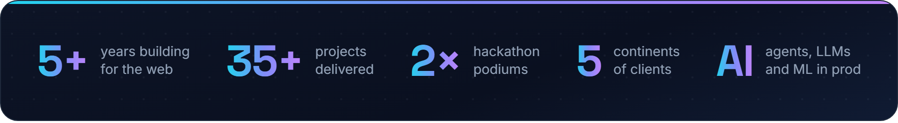

 

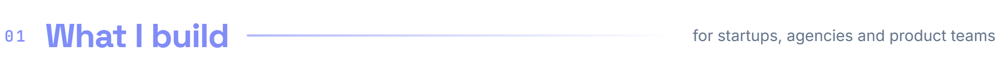

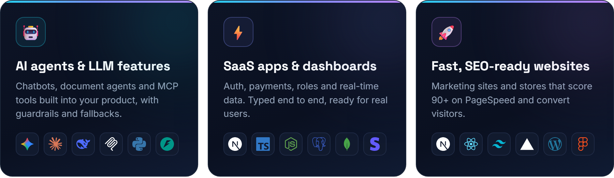

 

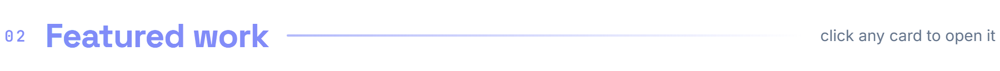

  <a href="https://nextgen-career.alshaimon.com">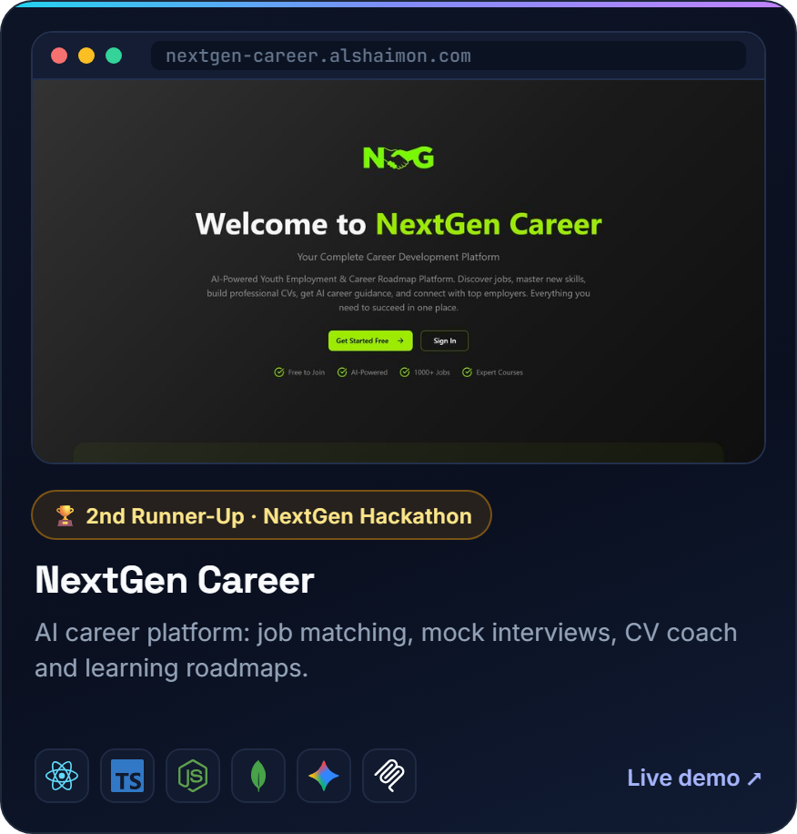</a>
  <a href="https://techwrite.alshaimon.com">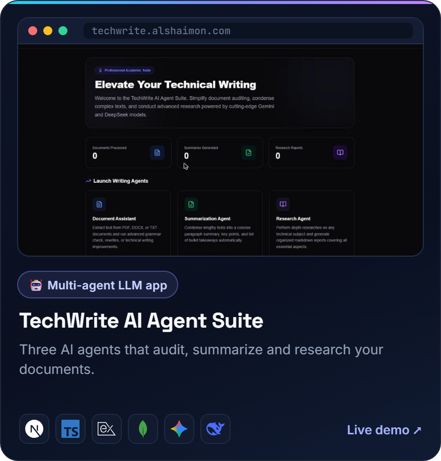</a>

  <a href="https://agroconnect.alshaimon.com">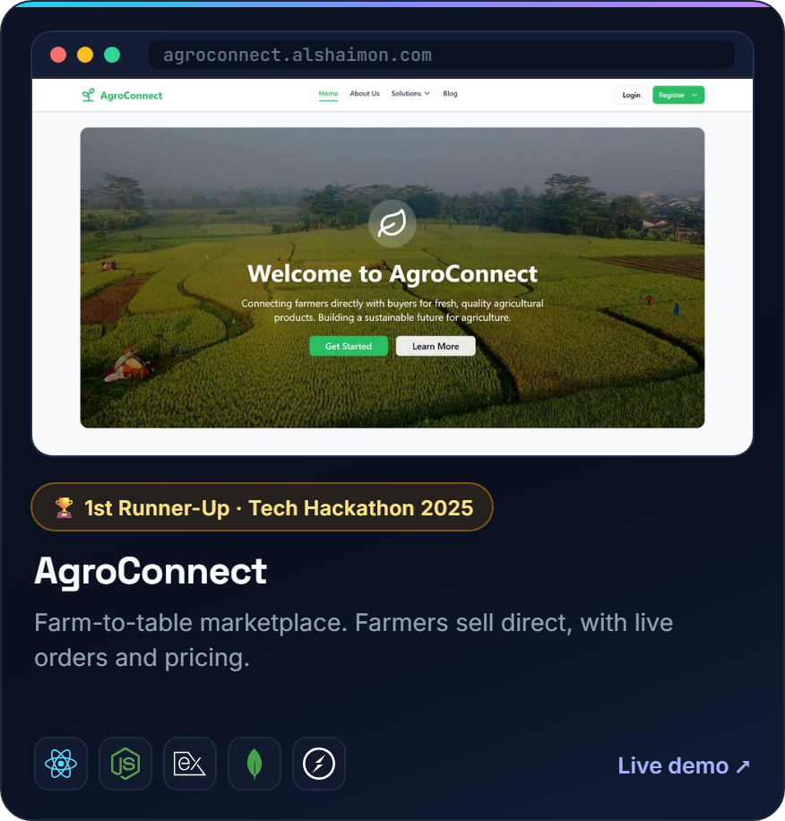</a>
  <a href="https://airadioroyaltytracker.com">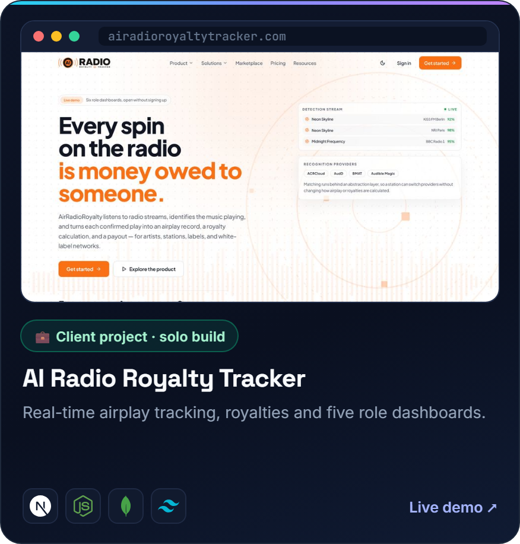</a>

  <a href="https://autoworx.tech">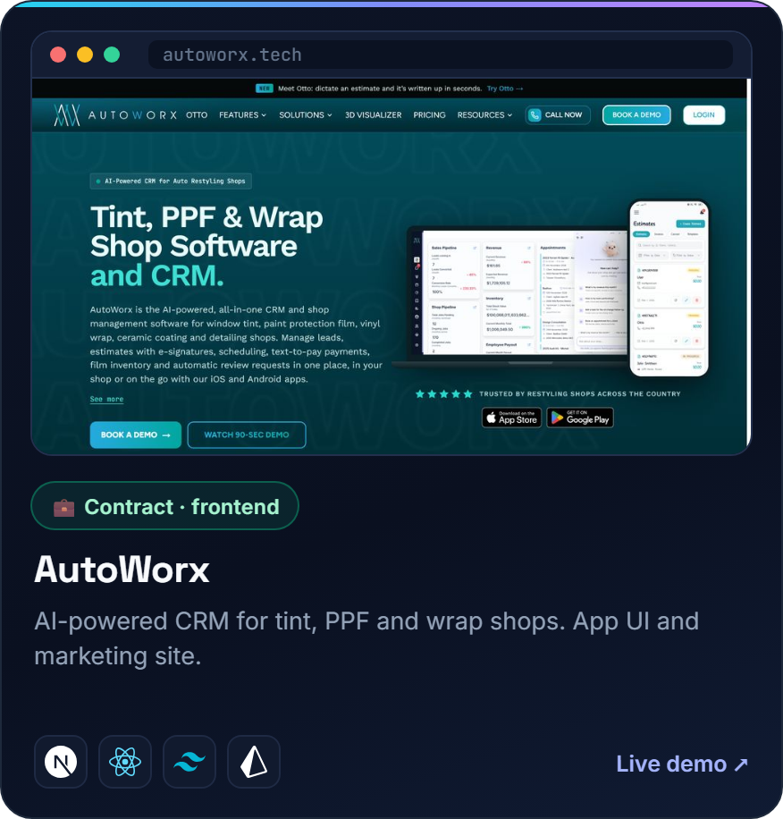</a>
  <a href="https://github.com/al-shaimon/VoxPay-client">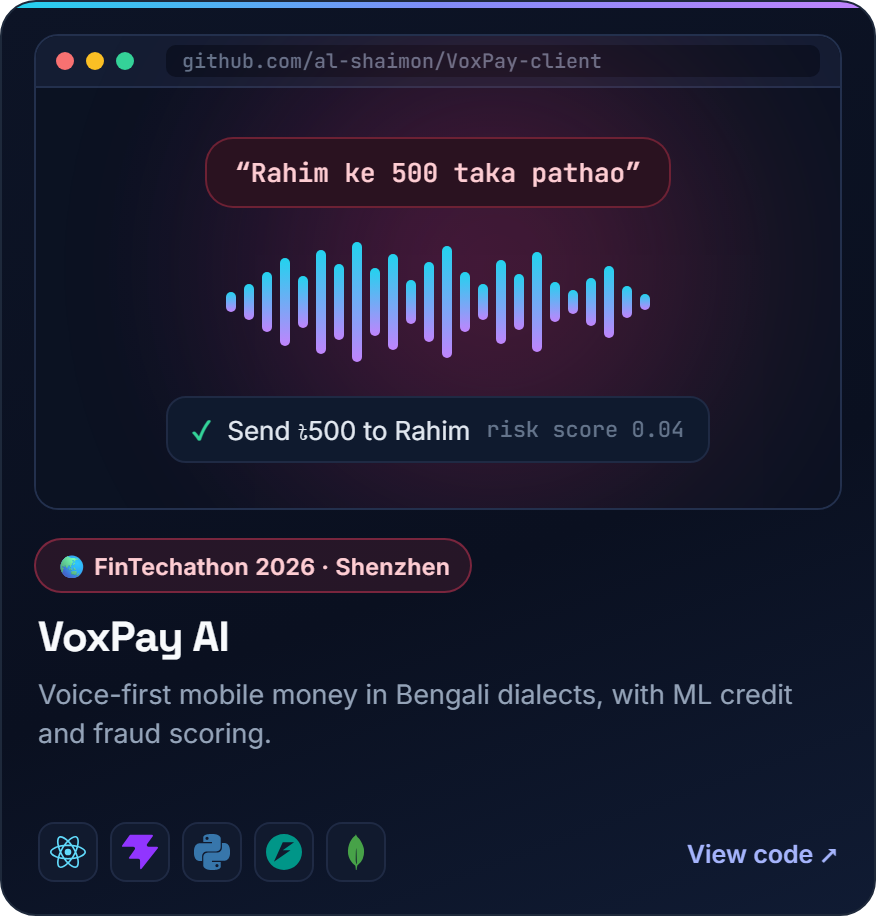</a>

  Source: <a href="https://github.com/al-shaimon/nextgen-career-frontend">NextGen</a> ·
  <a href="https://github.com/al-shaimon/techwrite-ai-agent">TechWrite</a> ·
  <a href="https://github.com/al-shaimon/agroconnect-frontend">AgroConnect</a> ·
  <a href="https://github.com/al-shaimon/VoxPay-server">VoxPay ML server</a> ·
  <a href="https://github.com/al-shaimon/smart-inventory-management-system">Smart Inventory</a>

 

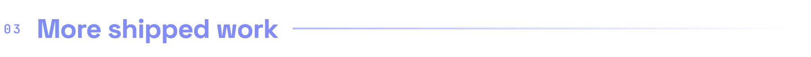

  <a href="https://thecontemporary.news">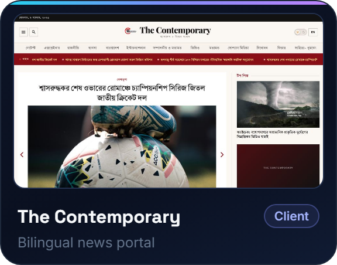</a>
  <a href="https://moise.care/en">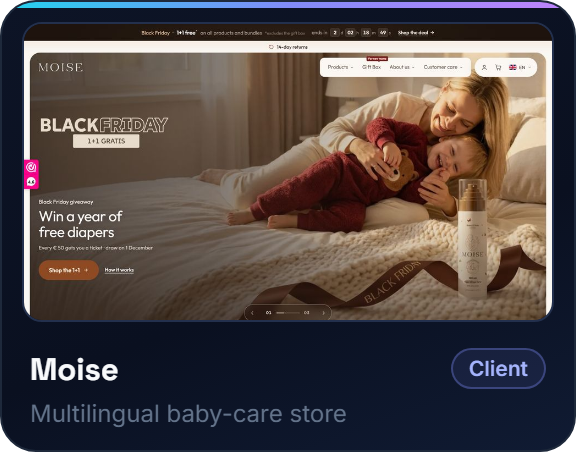</a>
  <a href="https://atctoolkit.com/facilities">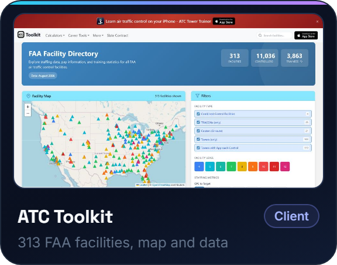</a>

  <a href="https://computerclub.iiuc.ac.bd">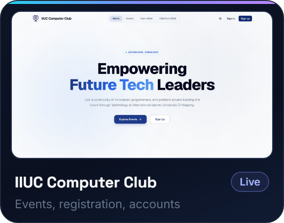</a>
  <a href="https://hfm.alshaimon.com">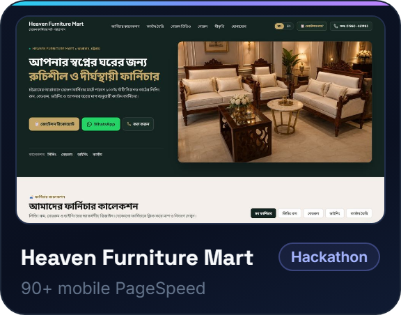</a>
  <a href="https://hope-bridge.alshaimon.com">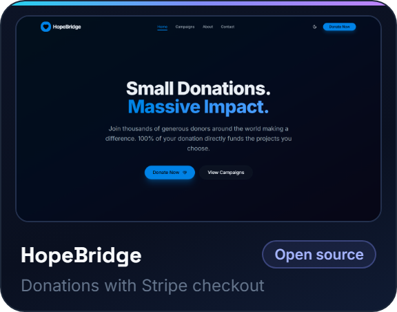</a>

 

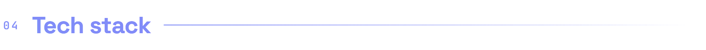

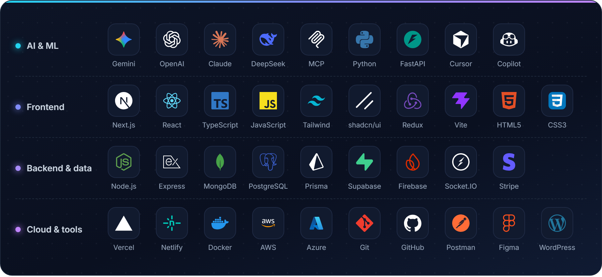

 

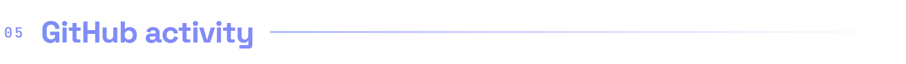

  <picture>
    <source media="(prefers-color-scheme: dark)" srcset="https://streak-stats.demolab.com?user=al-shaimon&theme=transparent&hide_border=true&ring=818CF8&fire=22D3EE&currStreakLabel=818CF8&sideLabels=C9D1D9&currStreakNum=FFFFFF&sideNums=FFFFFF&dates=8B949E&stroke=30363D" />
    
  </picture>

  <picture>
    <source media="(prefers-color-scheme: dark)" srcset="https://github-readme-activity-graph.vercel.app/graph?username=al-shaimon&bg_color=00000000&color=C9D1D9&line=818CF8&point=22D3EE&area=true&area_color=818CF8&hide_border=true&custom_title=Contribution%20activity" />
    
  </picture>

 

<a href="mailto:alshaimon152@gmail.com">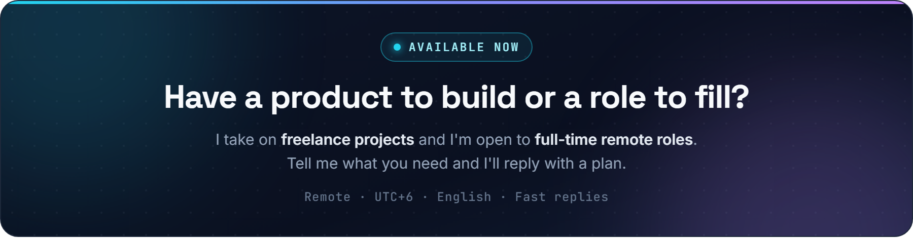</a>

  
  
  
  

