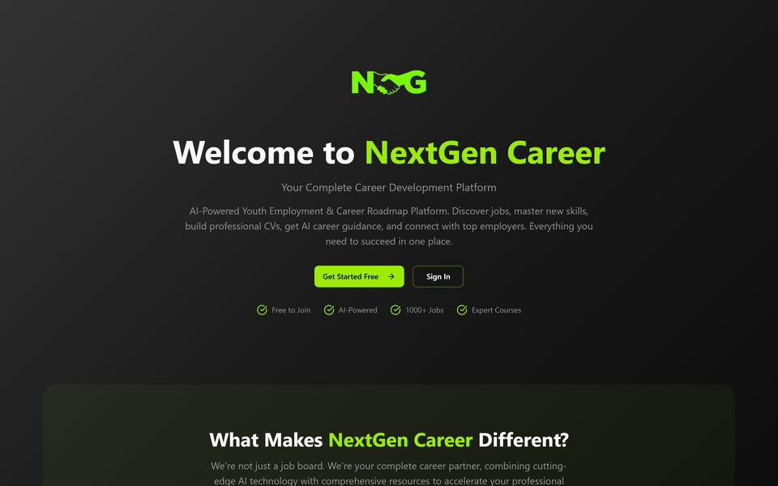
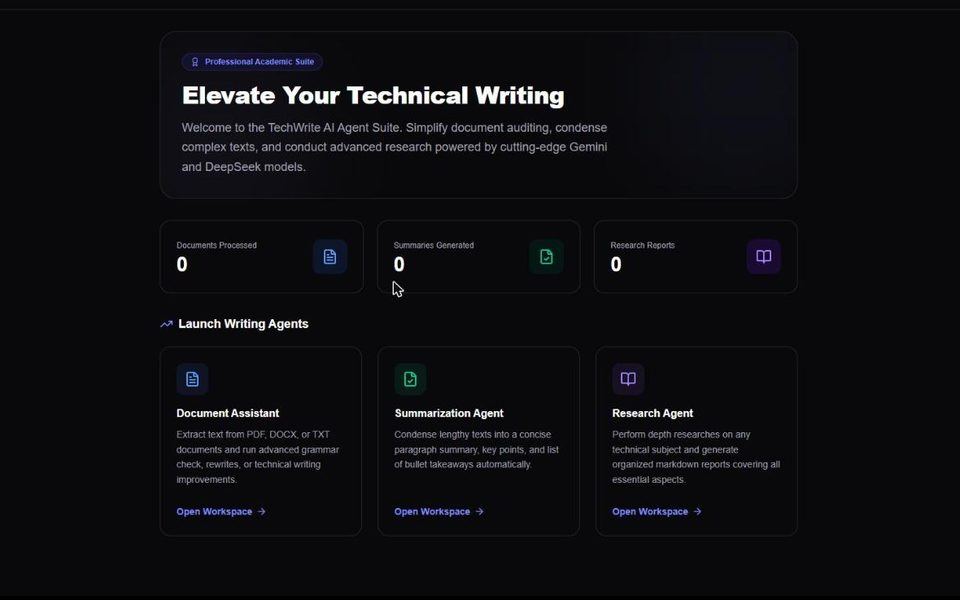
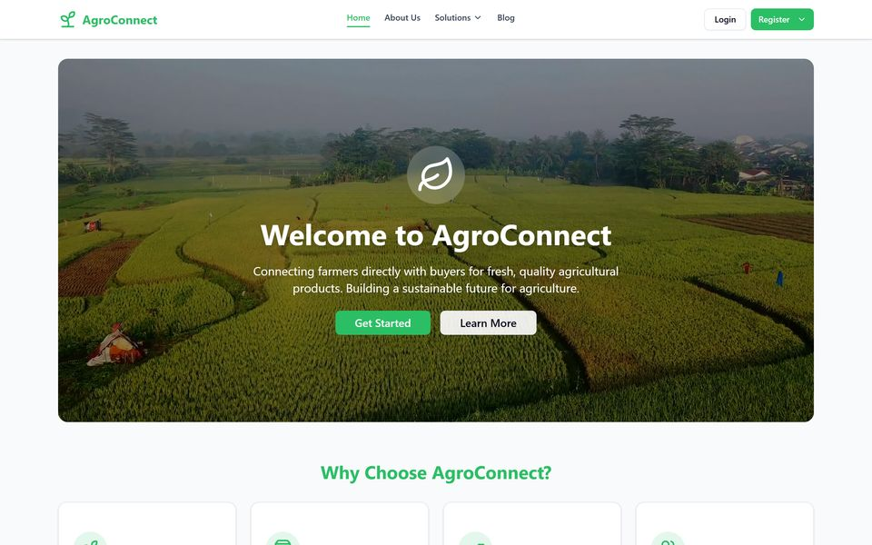
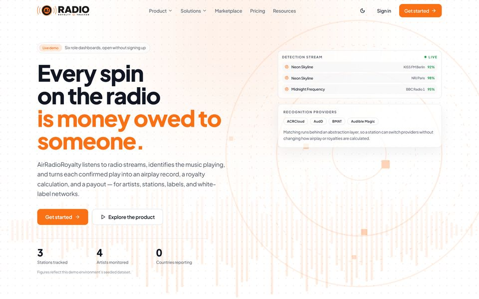
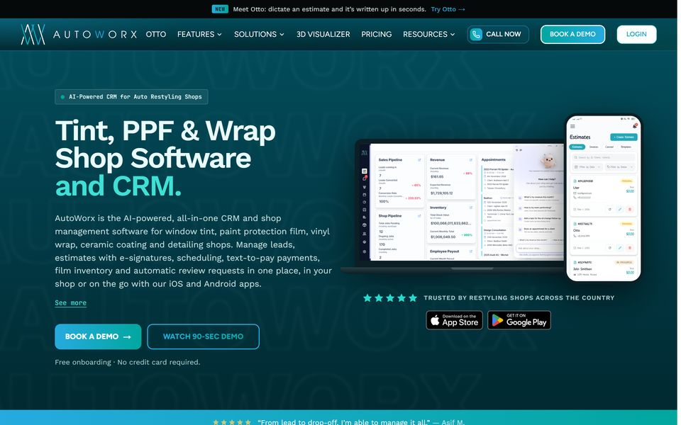
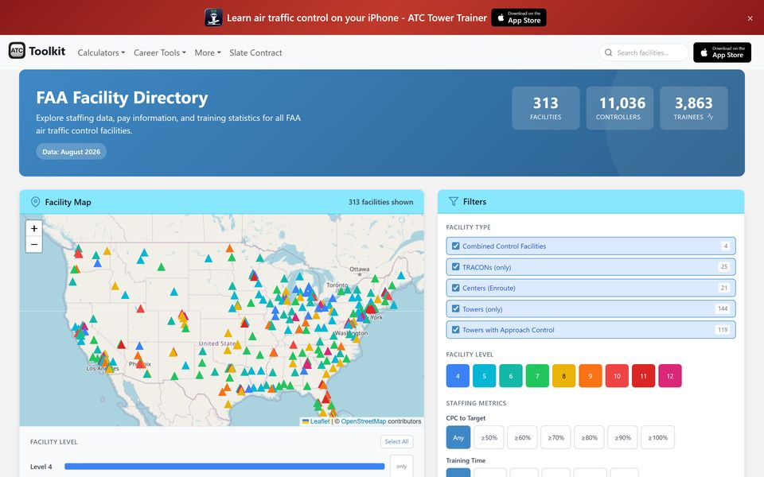
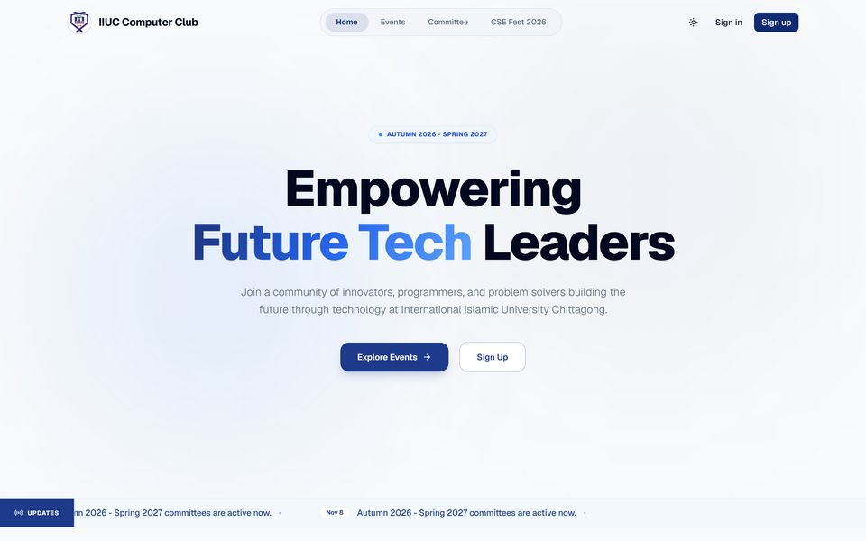
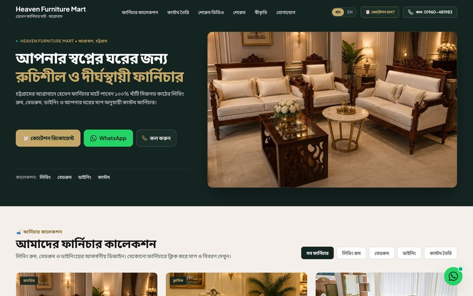

  

  
  
  
  
  

  
  
  

---

## `> whoami`

I'm **Abdullah** — a full-stack engineer who builds **AI into real products**. I design the interface, the API, the data model *and* the intelligence layer: LLM agents, AI assistants, ML-backed scoring and the plumbing that makes them reliable in production.

Since 2023 I've shipped work for clients in the US, Europe, Africa, Asia and Australia through **Upwork** and **Fiverr** — from SaaS dashboards and news portals to AI-powered platforms — while studying **CSE at International Islamic University Chittagong**.

<table>
  <tr>
    <td>🧠 <b>Focus</b></td>
    <td>AI-powered web products · LLM agents · SaaS dashboards · multi-tenant systems</td>
  </tr>
  <tr>
    <td>⚡ <b>Core stack</b></td>
    <td>Next.js · React · TypeScript · Node.js · Express · Python / FastAPI · MongoDB · PostgreSQL · Prisma</td>
  </tr>
  <tr>
    <td>🏆 <b>Recognition</b></td>
    <td>1st Runner-Up, Intra-Department Tech Hackathon 2025 · 2nd Runner-Up, NextGen Hackathon (IIUC TechFest 2025)</td>
  </tr>
  <tr>
    <td>📈 <b>Track record</b></td>
    <td>5+ years building for the web · 35+ projects delivered · client work live on 5 continents</td>
  </tr>
  <tr>
    <td>🎓 <b>Education</b></td>
    <td>BSc in Computer Science &amp; Engineering, IIUC (2023 – present)</td>
  </tr>
</table>

---

## 🧠 AI engineering

I treat AI as a product feature, not a demo. What that looks like in my work:

| What I build | Where I've shipped it |
|---|---|
| **Multi-agent LLM apps** — document auditing, summarization and research agents that read PDFs/DOCX and return structured Markdown | [TechWrite AI Agent Suite](https://techwrite.alshaimon.com) (Gemini + DeepSeek) |
| **AI career assistants** — chatbot guidance, AI mock interviews, CV improvement, job-match scoring and learning roadmaps | [NextGen Career](https://nextgen-career.alshaimon.com) (Gemini API + an MCP server) |
| **ML in the loop** — FastAPI gateway to a calibrated credit-risk &amp; fraud model, with failover when the model service sleeps | [VoxPay AI](https://github.com/al-shaimon/VoxPay-server) (FinTechathon 2026 build) |
| **Voice interfaces** — intent parsing from Bengali dialect speech, text-to-speech replies | [VoxPay AI](https://github.com/al-shaimon/VoxPay-client) |
| **AI features in client SaaS** — AI press-kit studio, AI-written product descriptions, AI-assistant UIs | AI Radio Royalty Tracker · Shopify public app · AutoWorx |
| **AI-native engineering** — I build with Claude Code, Cursor and Copilot daily, and review every line that ships | every project on this page |

  
  
  
  
  
  
  
  
  
  

---

## ⭐ Flagship projects

<table>
  <tr>
    <td width="50%" valign="top">
      
      <h3>NextGen Career</h3>
      
      
AI-powered youth employment platform (SDG 8): job matching with match %, AI CareerBot, mock interviews, CV improvement, learning roadmaps, verified employers and Stripe / SSLCommerz payments — in English and Bangla. <i>I led the team's build.</i>

      <code>React 19</code> <code>TypeScript</code> <code>Node.js</code> <code>MongoDB</code> <code>Gemini</code> <code>MCP</code>  
      <a href="https://nextgen-career.alshaimon.com"><b>Live site ↗</b></a> · <a href="https://github.com/al-shaimon/nextgen-career-frontend">Client</a> · <a href="https://github.com/al-shaimon/nextgen-career-server">Server</a>
    </td>
    <td width="50%" valign="top">
      
      <h3>TechWrite AI Agent Suite</h3>
      
      
Three AI agents in one workspace: a <b>Document Assistant</b> that extracts PDF / DOCX / TXT and rewrites or audits it, a <b>Summarization Agent</b> and a <b>Research Agent</b> that writes structured Markdown reports — powered by Gemini and DeepSeek.

      <code>Next.js</code> <code>TypeScript</code> <code>Express</code> <code>MongoDB</code> <code>Zod</code>  
      <a href="https://techwrite.alshaimon.com"><b>Live site ↗</b></a> · <a href="https://github.com/al-shaimon/techwrite-ai-agent">Client</a> · <a href="https://github.com/al-shaimon/techwrite-ai-agent-server">Server</a>
    </td>
  </tr>
  <tr>
    <td width="50%" valign="top">
      
      <h3>AgroConnect</h3>
      
      
Farm-to-table supply chain for Chattogram: farmers sell directly to buyers with no middlemen. Farmer and buyer dashboards, price control, order tracking, real-time produce availability and live updates.

      <code>React</code> <code>Node.js</code> <code>Express</code> <code>MongoDB</code> <code>Socket.IO</code>  
      <a href="https://agroconnect.alshaimon.com"><b>Live site ↗</b></a> · <a href="https://github.com/al-shaimon/agroconnect-frontend">Client</a> · <a href="https://github.com/al-shaimon/agroconnect-backend">Server</a>
    </td>
    <td width="50%" valign="top">
      
      <h3>AI Radio Royalty Tracker</h3>
      
      
Global platform that tracks radio airplay in real time, calculates royalties, licenses music and sells airtime — with separate dashboards for artists, stations, listeners, partners and admins, plus an AI press-kit studio. Built solo, front to back.

      <code>Next.js</code> <code>Node.js</code> <code>MongoDB</code> <code>Tailwind</code>  
      <a href="https://airadioroyaltytracker.com"><b>Live site ↗</b></a>
    </td>
  </tr>
  <tr>
    <td width="50%" valign="top">
      
      <h3>AutoWorx</h3>
      
      
AI-powered CRM and shop software for tint, PPF and wrap shops. I built the app frontend — appointments, staff and finance dashboards — and the public marketing site.

      <code>Next.js</code> <code>React</code> <code>Tailwind</code> <code>Prisma</code>  
      <a href="https://autoworx.tech"><b>Live site ↗</b></a>
    </td>
    <td width="50%" valign="top">
      <h3>🎙️ VoxPay AI</h3>
      
      
Voice-first mobile money for rural and unbanked users. People speak in their own Bengali dialect (Chittagonian, Sylheti, Banglish...) to send money, pay bills or request a loan. A FastAPI gateway calls a calibrated ML model for <b>credit scoring and fraud detection</b>, with a local fallback when the model is cold.

      <code>React 19</code> <code>Vite</code> <code>Python</code> <code>FastAPI</code> <code>MongoDB</code> <code>ML</code>  
      <a href="https://github.com/al-shaimon/VoxPay-client"><b>Client ↗</b></a> · <a href="https://github.com/al-shaimon/VoxPay-server">Server + ML integration</a>
        
      <h3>📦 Smart Inventory (SIMS)</h3>
      
Multi-tenant inventory &amp; order management with strict data isolation, RBAC, team invites, restock intelligence and analytics.

      <code>Next.js 16</code> <code>TypeScript</code> <code>MongoDB</code> <code>Zod</code>  
      <a href="https://sims.alshaimon.com"><b>Live site ↗</b></a> · <a href="https://github.com/al-shaimon/smart-inventory-management-system">Code</a>
    </td>
  </tr>
</table>

---

## 💼 Client work in production

<table>
  <tr>
    <td width="33%" valign="top" align="center">
       
      <b><a href="https://thecontemporary.news">The Contemporary</a></b> 
      Bilingual Bangla / English news portal · Next.js
    </td>
    <td width="33%" valign="top" align="center">
       
      <b><a href="https://moise.care/en">Moise</a></b> 
      Multilingual baby-care e-commerce store · Next.js
    </td>
    <td width="33%" valign="top" align="center">
       
      <b><a href="https://atctoolkit.com/facilities">ATC Toolkit</a></b> 
      Directory of 313 FAA facilities with map &amp; data · Next.js
    </td>
  </tr>
  <tr>
    <td width="33%" valign="top" align="center">
       
      <b><a href="https://computerclub.iiuc.ac.bd">IIUC Computer Club</a></b> 
      Official club site: events, registration, accounts · built solo
    </td>
    <td width="33%" valign="top" align="center">
       
      <b><a href="https://hfm.alshaimon.com">Heaven Furniture Mart</a></b> 
      Bangla showroom site, 90+ mobile PageSpeed · hackathon
    </td>
    <td width="33%" valign="top">
      <b>Also shipped</b>
      <ul>
        <li>Public <b>Shopify app</b> that imports products and writes descriptions with AI</li>
        <li>WordPress / Elementor sites for real-estate brands in <b>Dakar</b>, <b>Singapore</b> and <b>Florida</b></li>
        <li>NDIS training platform for an <b>Australian</b> provider</li>
        <li>Lead-gen landing pages for US property buyers</li>
      </ul>
    </td>
  </tr>
</table>

---

## 🧪 More open-source builds

| Project | What it shows | Links |
|---|---|---|
| **HopeBridge** | Donation platform with Stripe checkout via Server Actions, dark mode and dynamic SEO | [Live](https://hope-bridge.alshaimon.com) · [Code](https://github.com/al-shaimon/HopeBridge) |
| **Heaven Furniture Mart** | Performance-tuned Next.js 16 site with lazy video streaming and 90+ Core Web Vitals | [Live](https://hfm.alshaimon.com) · [Code](https://github.com/al-shaimon/heaven-furniture-mart) |
| **ZKart** | Multi-vendor e-commerce: customer / vendor / admin roles, JWT refresh, Stripe, Prisma + PostgreSQL | [Live](https://zkart-frontend.vercel.app) · [Client](https://github.com/al-shaimon/zkart-frontend) · [Server](https://github.com/al-shaimon/zkart-backend) |
| **Hybrid EDF + Round-Robin Scheduler** | Visual CPU-scheduling simulator — CS fundamentals made interactive | [Code](https://github.com/al-shaimon/Hybrid-EDF-Round-Robin-Scheduler-Web-Application) |
| **System Monitor** | Real-time system metrics dashboard in TypeScript | [Live](https://system-monitor-six.vercel.app) · [Code](https://github.com/al-shaimon/system-monitor) |

---

## 🧰 Toolbox

<table>
  <tr>
    <td><b>AI &amp; ML</b></td>
    <td> &nbsp; Gemini · OpenAI · DeepSeek · MCP · LLM agents · document-processing pipelines</td>
  </tr>
  <tr>
    <td><b>Languages</b></td>
    <td></td>
  </tr>
  <tr>
    <td><b>Frontend</b></td>
    <td></td>
  </tr>
  <tr>
    <td><b>Backend &amp; Data</b></td>
    <td></td>
  </tr>
  <tr>
    <td><b>Cloud &amp; Tools</b></td>
    <td></td>
  </tr>
</table>

---

## 🤝 How I work

- **AI where it earns its place** — I add LLMs and ML when they solve a user problem, with fallbacks, validation and cost in mind.
- **Production-ready, not demo-ready** — typed end to end, validated inputs, sensible error handling, real auth and payments.
- **Performance is a feature** — Lighthouse, Core Web Vitals and SEO are part of the definition of done.
- **Clear communication** — fast replies, honest timelines and regular progress updates for remote clients.

---

## 📈 GitHub activity

  <picture>
    <source media="(prefers-color-scheme: dark)" srcset="https://streak-stats.demolab.com?user=al-shaimon&theme=transparent&hide_border=true&ring=818CF8&fire=22D3EE&currStreakLabel=818CF8&sideLabels=C9D1D9&currStreakNum=FFFFFF&sideNums=FFFFFF&dates=8B949E&stroke=30363D" />
    
  </picture>

  <picture>
    <source media="(prefers-color-scheme: dark)" srcset="https://github-readme-activity-graph.vercel.app/graph?username=al-shaimon&bg_color=00000000&color=C9D1D9&line=818CF8&point=22D3EE&area=true&area_color=818CF8&hide_border=true&custom_title=Contribution%20activity" />
    
  </picture>

---

  <b>Building something that needs a full-stack engineer who speaks AI?</b> 
  <a href="mailto:alshaimon152@gmail.com">Email me</a> · <a href="https://linkedin.com/in/al-shaimon">LinkedIn</a> · <a href="https://alshaimon.com">Portfolio</a>

