

  
  
  
  
  

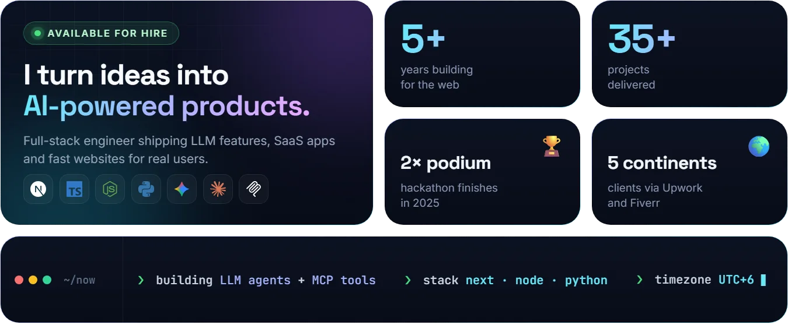

  

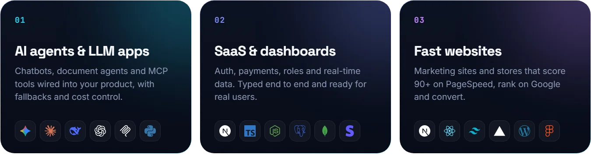

  

  <a href="https://nextgen-career.alshaimon.com">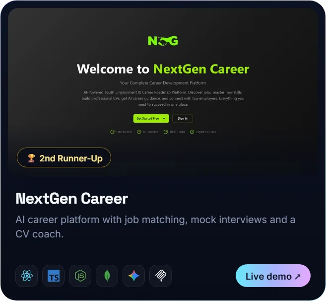</a>
  <a href="https://techwrite.alshaimon.com">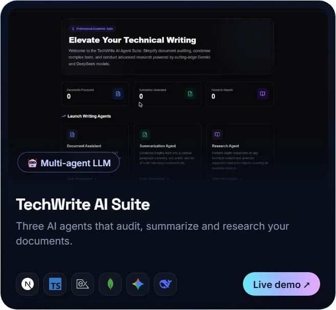</a>
  <a href="https://agroconnect.alshaimon.com">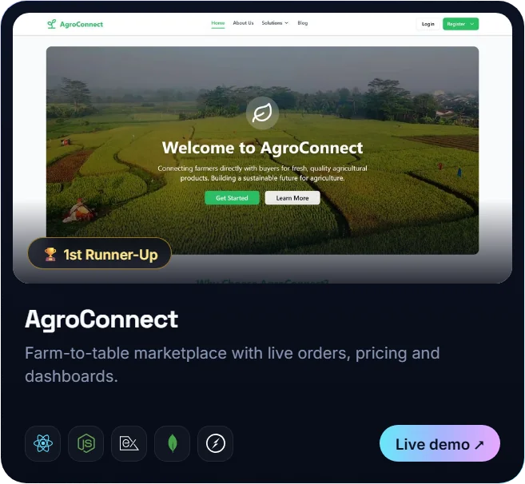</a>
  <a href="https://airadioroyaltytracker.com">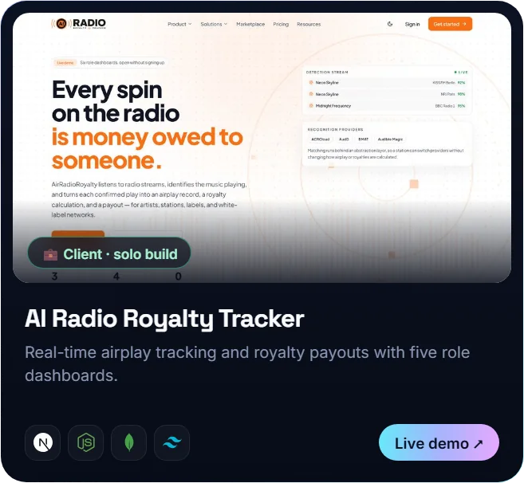</a>
  <a href="https://autoworx.tech">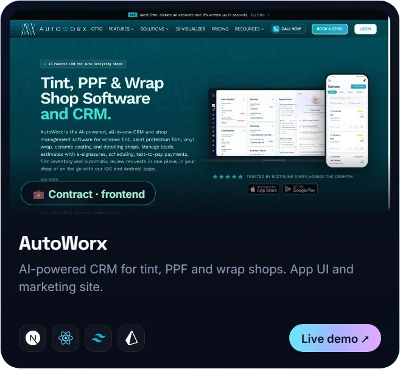</a>
  <a href="https://github.com/al-shaimon/VoxPay-client">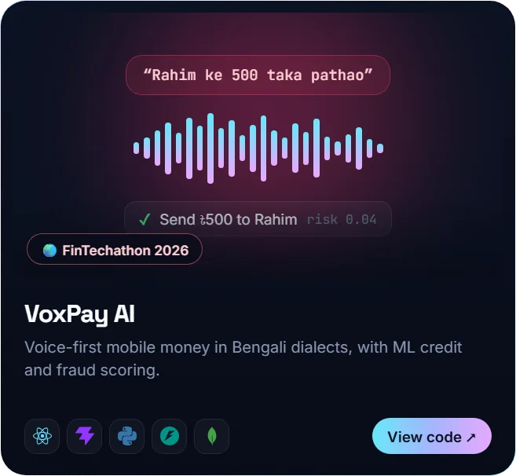</a>

  Source code: <a href="https://github.com/al-shaimon/nextgen-career-frontend">NextGen</a> ·
  <a href="https://github.com/al-shaimon/techwrite-ai-agent">TechWrite</a> ·
  <a href="https://github.com/al-shaimon/agroconnect-frontend">AgroConnect</a> ·
  <a href="https://github.com/al-shaimon/VoxPay-server">VoxPay ML server</a> ·
  <a href="https://github.com/al-shaimon/smart-inventory-management-system">Smart Inventory</a>

 

  <a href="https://thecontemporary.news">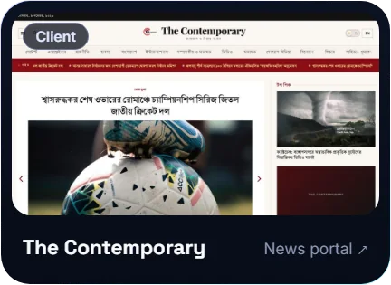</a>
  <a href="https://moise.care/en">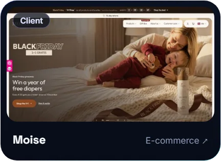</a>
  <a href="https://atctoolkit.com/facilities">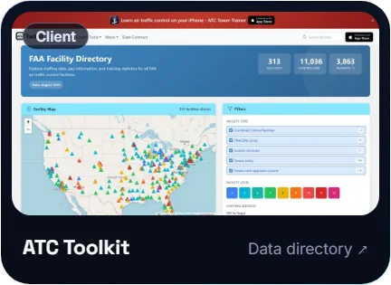</a>
  <a href="https://computerclub.iiuc.ac.bd">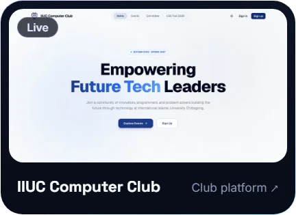</a>
  <a href="https://hfm.alshaimon.com">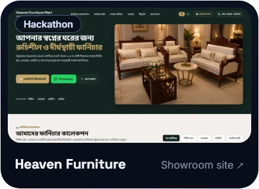</a>
  <a href="https://hope-bridge.alshaimon.com">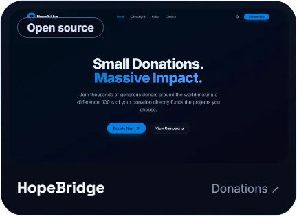</a>

 

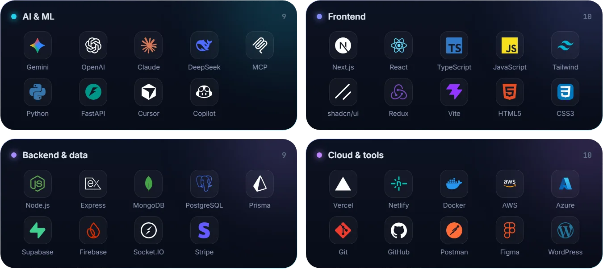

  

  <picture>
    <source media="(prefers-color-scheme: dark)" srcset="https://streak-stats.demolab.com?user=al-shaimon&theme=transparent&hide_border=true&ring=818CF8&fire=22D3EE&currStreakLabel=818CF8&sideLabels=C9D1D9&currStreakNum=FFFFFF&sideNums=FFFFFF&dates=8B949E&stroke=30363D" />
    
  </picture>

 

<a href="https://wa.me/8801690174668?text=Hi%20Abdullah%21%20I%20found%20your%20GitHub%20profile%20and%20I%27d%20like%20to%20work%20with%20you.%0A%0AWhat%20I%20need%3A%0ATimeline%3A%0ABudget%20/%20role%20type%3A%0A%0AWhen%20is%20a%20good%20time%20to%20talk%3F">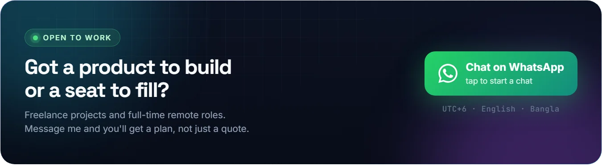</a>
